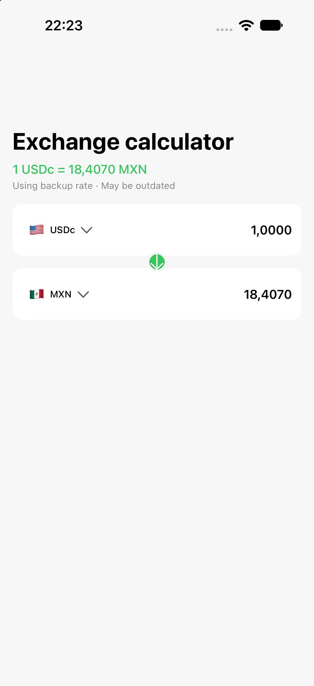
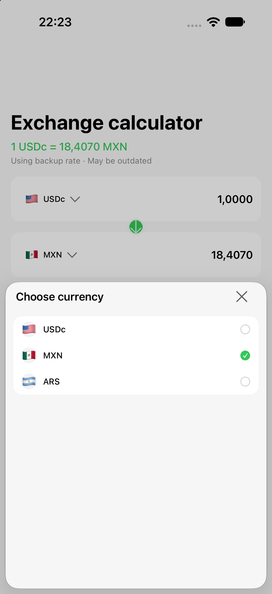

# CurrencyExchange

A currency conversion iOS application built with Swift, UIKit, and MVVM.

## Overview

Currency Exchange is an iOS application that allows users to convert amounts between different currencies using exchange rates retrieved from an external API.

## Tech Stack

* Language: Swift
* UI Framework: UIKit
* Layout: Auto Layout
* Architecture: MVVM (Model-View-ViewModel)
* Networking: URLSession

## Features

* Currency conversion using exchange rates.

* Source and target currency selection.

* Currency swapping.

* Bidirectional amount input.

* Exchange rate fetching via REST API.

* In-memory caching and bundled fallback data.

* Input validation for decimal amounts.

* Loading and error states.

## Architecture

MVVM separates business logic from UIKit components and makes currency conversion behaviour easier to unit test. For a small application, this is a practical alternative to more complex architectures such as VIPER.

* Model — represents the application's data.

* View — displays the user interface and handles user interactions.

* ViewModel — manages presentation logic and provides data for the View.

This separation helps keep the code organized and makes individual components easier to maintain.

## Requirements

* macOS with a compatible version of Xcode
* Swift version supported by the project
* iOS 18.6

## Getting Started

### 1. Clone the repository

```bash
git clone https://github.com/Leibnz/CurrencyExchange.git
```

### 2. Navigate to the project directory

```bash
cd CurrencyExchange
```

### 3. Open the project

```bash
open CurrencyExchange.xcodeproj
```

Alternatively, open `CurrencyExchange.xcodeproj` directly in Xcode.

### 4. Run the application

Select an iOS simulator, then press **Cmd + R** in Xcode to build and run the app.

## Screenshots

Screenshots will be added once they are captured from the running application.

<!-- Replace these placeholders with actual screenshots and commit the image files. -->
<!-- Example:  -->
<!-- Example:  -->

## Exchange Rate API

The app requests exchange-rate tickers from the DolarApp API:

- **Endpoint:** [DolarApp tickers API](https://api.dolarapp.dev/v1/tickers?currencies=MXN,ARS)
- **Method:** `GET`
- **Requested currencies:** MXN and ARS

The repository interprets `bid` and `ask` values for supported USDc currency pairs. If the remote request fails, it can use an in-memory cache or bundled fallback data.

## Known Limitations

- **Limited currency support:** The current implementation supports USDc, MXN, and ARS; it does not support every possible currency pair (for example, direct MXN-to-ARS conversion).
- **Temporary cache:** Exchange rates cached in memory are lost when the app terminates.
- **Potentially outdated fallback:** Bundled exchange rates are static and may not reflect current market conditions.
- **API dependency:** Live exchange rates require the external service to be available and return valid data.
- **Not for financial transactions:** Displayed conversions are estimates and should not be used as executable exchange quotes.
